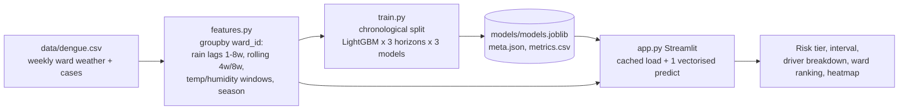

# Architecture

## 1. Data flow

## 2. Problem framing
Row = (ward, week). Features at week *t* only; target = cases at *t+h* for h ∈ {2,3,4}. One model per horizon,
so the forecast never uses information from the future. Rain lags 1–8 weeks cover the breeding clock
(egg→adult 7–14 d, incubation, reporting delay ⇒ 2–4 wk lag). Lags are computed **per `ward_id`** with `groupby().shift()`.

## 3. Chronological validation split (no shuffling)
| Split | Period | Use |
|---|---|---|
| Train | 2016–2022 | fit |
| Validation | 2023 | compare models/baselines, tune |
| Test | 2024–2025 | final report only; final model fit on train+val |

Random k-fold would leak neighbouring weeks of the same outbreak into training, so it is not used.
Baselines: global mean and per-ward seasonal (week-of-year) mean. Reported: MAE, RMSE, tier accuracy, 80% interval coverage.

## 4. Model selection rationale
LightGBM (Poisson objective for count data): handles non-linear lag interactions (e.g. rain × water-logging),
trains in seconds on 31k rows, exact per-prediction driver contributions (`pred_contrib`), no scaling needed.
Quantile (10/90%) models give forecast intervals. Risk tiers = percentile cut-offs (60/85/95th) of weekly cases
in the training period: Low / Medium / High / Critical.

## 5. Compute & API cost controls
- **Zero runtime API calls**: dataset is a local CSV; no weather or LLM API in the request path.
- **Serialized models** (`joblib`, compressed) loaded once via `st.cache_resource`; features built once via `st.cache_data`.
- **One vectorised `predict` per interaction** for all wards (not one call per ward).
- Training offline (~25 s CPU); retraining only when new data arrives.
- If a live weather API / LLM is added in the final: cache responses by (ward, week), fetch once per week, cap LLM tokens (short templated prompts, max_tokens limit, cached per ward-week).
